# Liquid Midnight

A reusable style system distilled from the Agent Workspaces keynote, its reels, and a recent product landing page:
- Apple **Midnight** grounds;
- **liquid glass** with a travelling **liquid-metal** chrome rim;
- real **WebGL glass plasma orbs**;
- a quiet **ASCII text shader**;
- **time-addressable** spring motion, so every frame can be rendered to video.

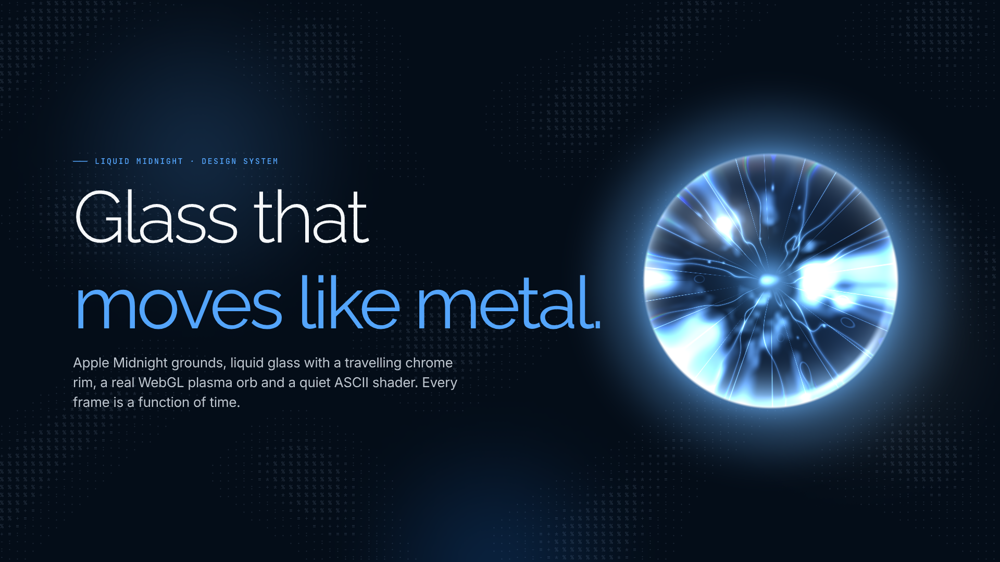

- **[DESIGN.md](DESIGN.md)** is the full contract: principles, do/don't (including every rejected look), tokens (OKLCH + hex), materials CSS, orb/ASCII/metal recipes, motion, formats and safe zones, accessibility, and how-to checklists for a keynote scene, a reel, a landing section and an app card.
- **`tokens/`** holds `tokens.json` (source of truth) and the generated `tokens.css` (night and day modes, graphite and abyss tones).
- **`css/materials.css`** has the glass, capsule, chip, chrome ring, metal text, counter, caption box and ambient light, plus accessibility fallbacks.
- **`kit/`** is a framework-agnostic ES-module render kit (canvas helpers, metal ribbons and rings, the ASCII shader, the WebGL orb, the render loop). It is extracted from the deck, with provenance comments.
- **`specimen/index.html`** is a live specimen of every token, material and component in motion.
- **`design/liquid-midnight.pen`** holds the Pencil boards (palette, type, materials, components, orb/ASCII, motion, formats). The orb and ASCII field there are live shader fills (`design/shaders/`).

## Use

```bash
bun install
bunx playwright install chromium   # once: the browser used by `render` and `verify`
bun run serve      # http://localhost:4317/specimen/  (?mode=day, ?t=6 for a deterministic frame)
bun run render     # re-render docs/renders/*.png (night + day) with headless Chromium
bun run tokens     # regenerate tokens.css + DESIGN.md tables after editing tokens.json
bun run check      # tokens up to date, Biome, tests
```

Copy (or vendor) the repo into your site as `liquid-midnight/`, serve it over http (ES modules do not load from `file://`), then:

```html
<link rel="stylesheet" href="./liquid-midnight/tokens/tokens.css">
<link rel="stylesheet" href="./liquid-midnight/css/materials.css">
<div class="lm-glass lm-card"><span class="lm-tag"><b></b>Layer 01</span><h3 class="lm-card-title">Primer</h3></div>
<script type="module">
  import { use, readColors, createLoop, asciiBackground, orb, metalRing } from "./liquid-midnight/kit/index.js";
</script>
```

With a bundler, the package exports `liquid-midnight/kit`, `liquid-midnight/tokens.css` and `liquid-midnight/materials.css`. The `liquid-midnight` skill in [broomva/skills](https://github.com/broomva/skills) installs the same assets with a starter scene.

## Renders

| Specimen (night) | Specimen (day / paper) |
|---|---|
| 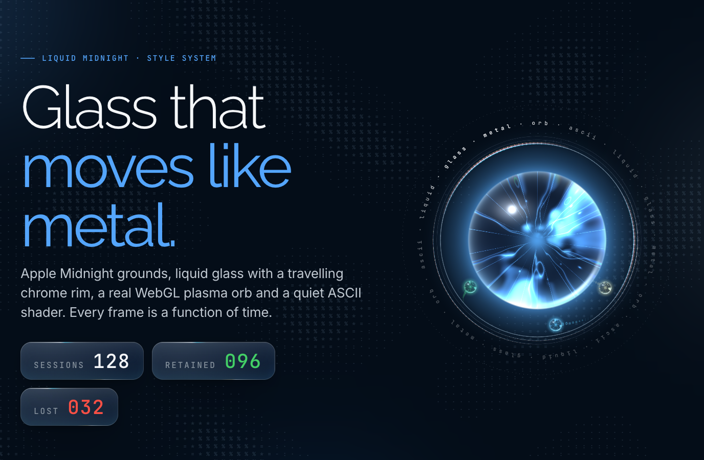 | 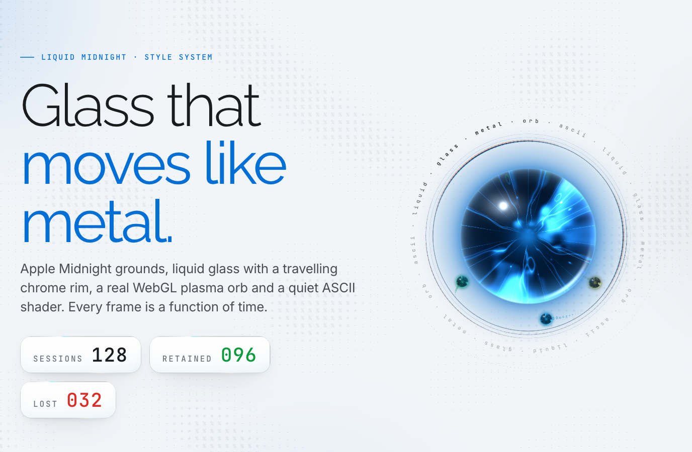 |
| 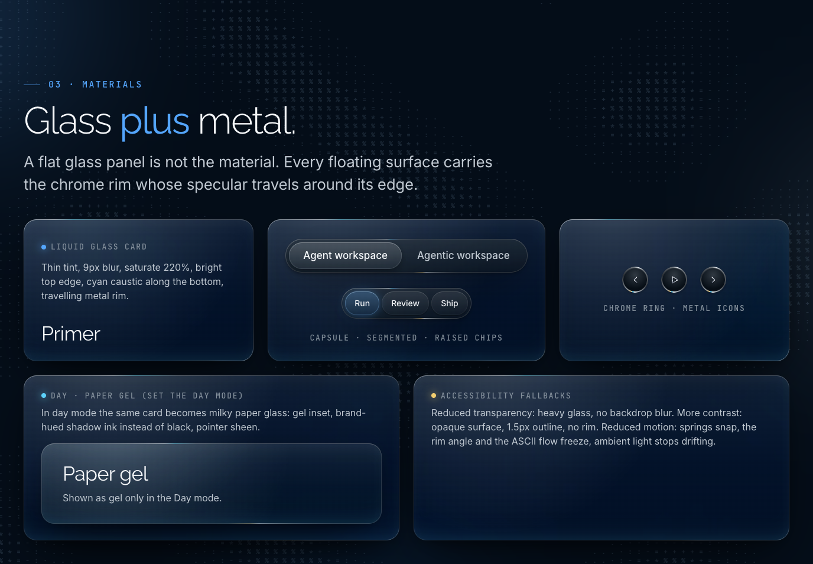 | 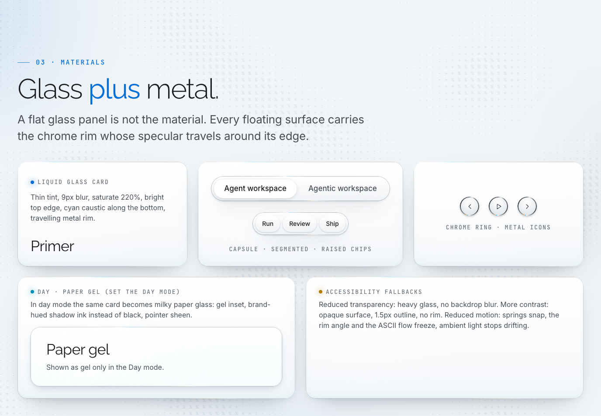 |
| 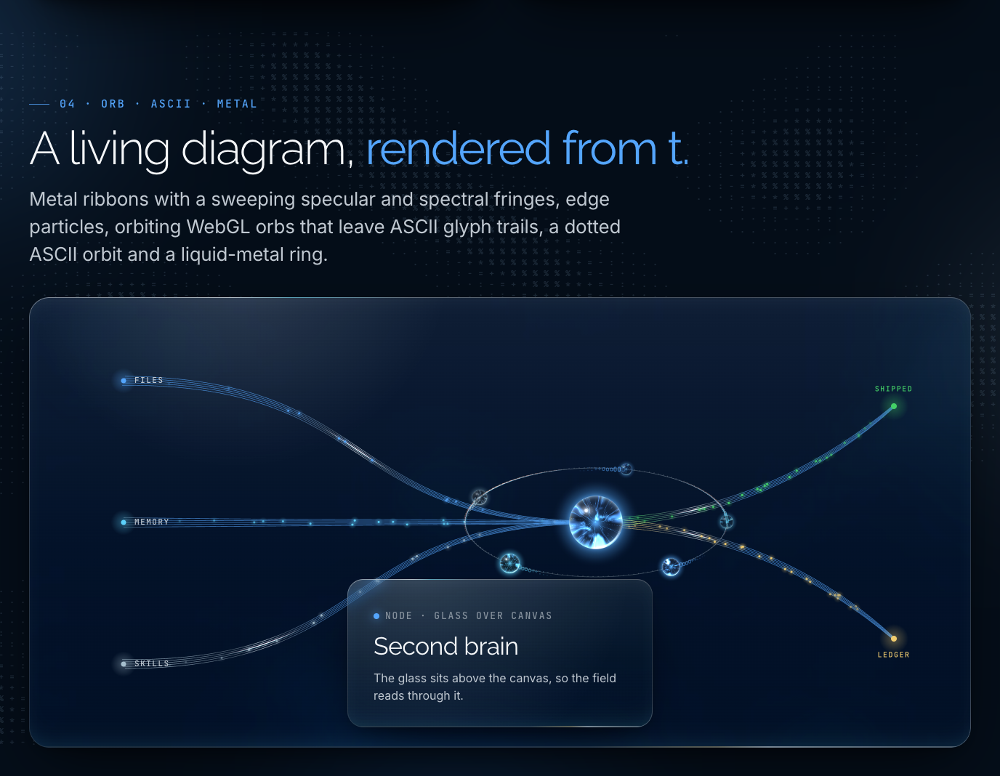 | 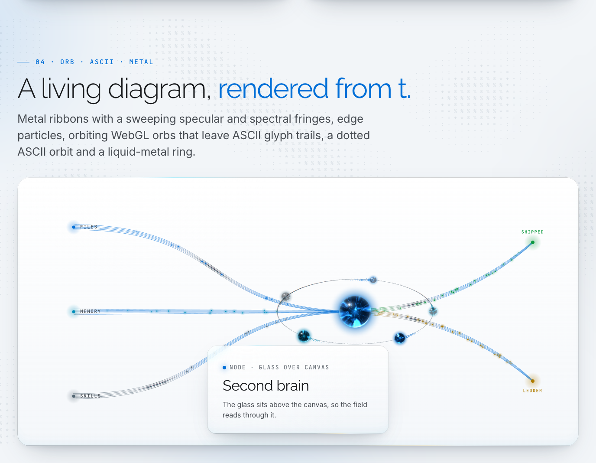 |

| Pencil boards | |
|---|---|
| 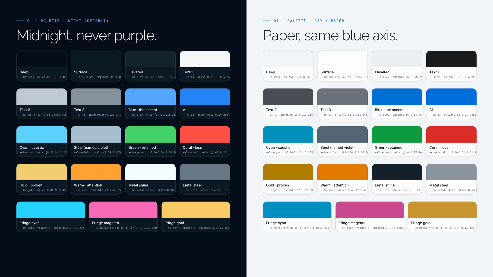 | 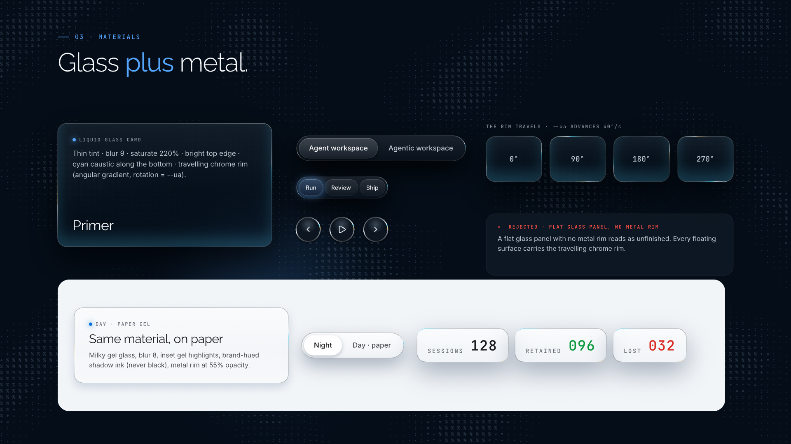 |
| 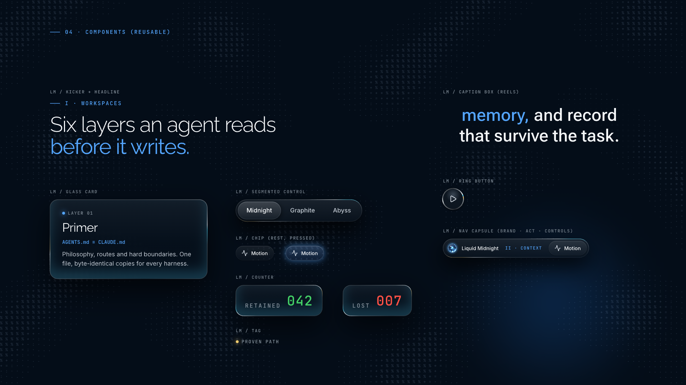 | 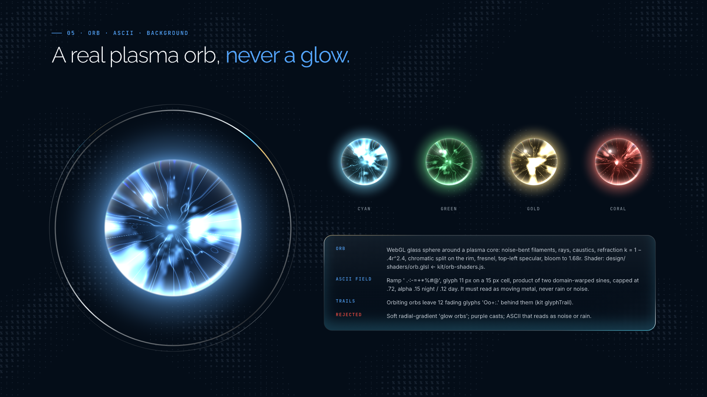 |
| 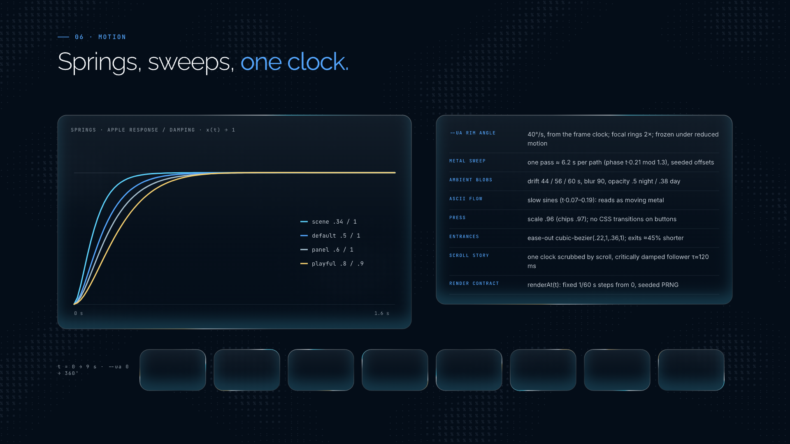 | 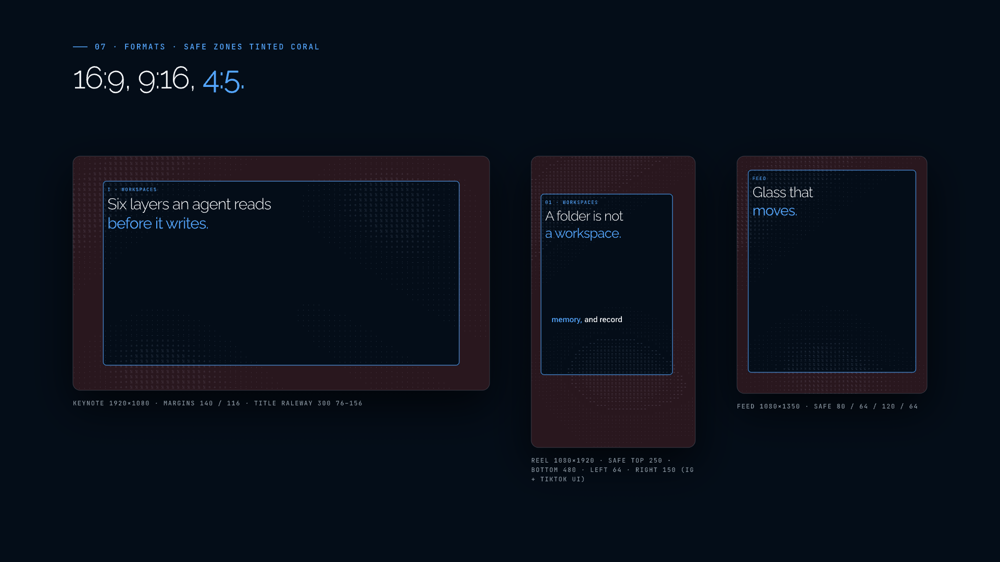 |

All specimen sections, in both modes: [`docs/renders/`](docs/renders/).

## Provenance and licence

The code is Apache-2.0 (see `LICENSE`). The render kit and material CSS are extracted from [broomva/agent-workspaces](https://github.com/broomva/agent-workspaces) (`deck/index.html` @`187972f`, Apache-2.0). Each file names its source lines. The fonts in `fonts/` are SIL OFL 1.1; their licence texts sit alongside the font files.
